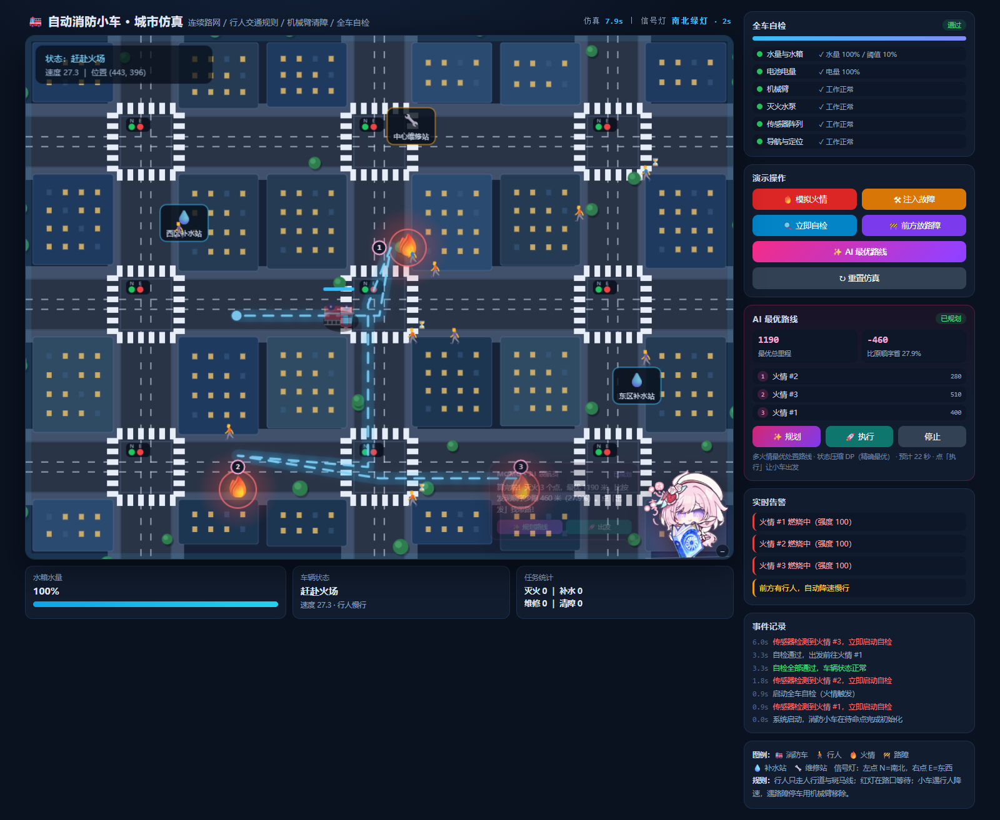
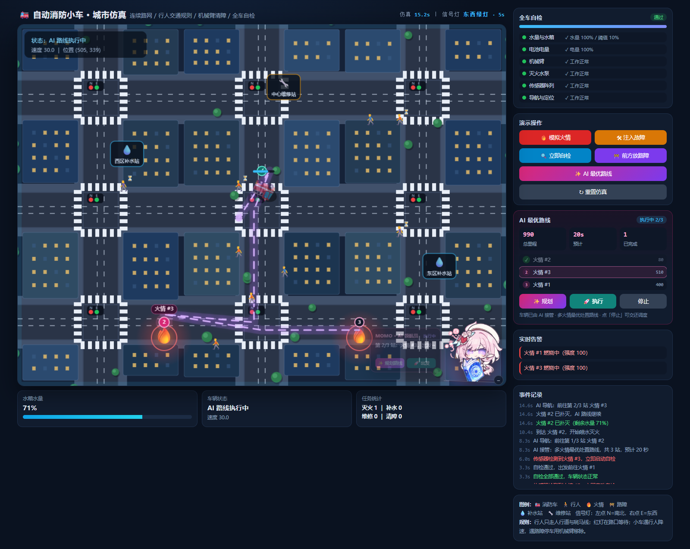
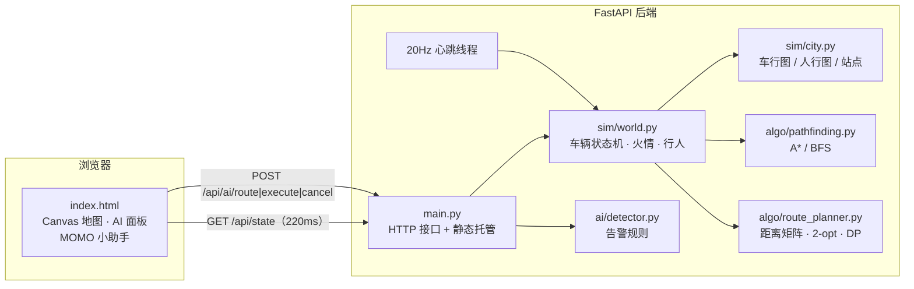
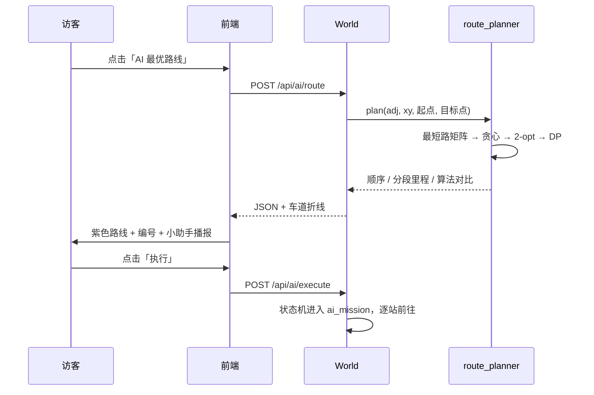

# 🚒 自动消防小车 · 城市交通仿真（AI 最优路线版）

> 一台带机械臂的消防小车，在连续坐标的城市路网中完成 **自检 → 出警 → 灭火 → 补水 / 维修 → 清障 → 避让行人** 的完整闭环；
> 新增的 **AI 领航员 MOMO** 会在地图上算出一条「一次出车、多点火情」的最优处置路线，并可以一键接管车辆执行。

**在线演示**：部署后把地址填在这里 → `https://<your-app>.onrender.com`
**本地体验**：启动后打开 <http://127.0.0.1:8000>



---

## 项目能做什么

| 能力 | 说明 |
| --- | --- |
| 🤖 **AI 最优路线** | 点击「✨ AI 最优路线」，A* 先算出目标点两两最短路，再用 2-opt / 状态压缩 DP 求出访问顺序，地图上画出紫色光带与编号站点，一键交给小车执行 |
| 🧑‍🚀 **AI 领航员 MOMO** | 页面右下角的 Live2D 风格小助手：会呼吸、会漂浮、会眨眼式闪烁；点她有台词，规划时进入「思考」状态，执行时实时播报下一站 |
| 🔍 全车自检 | 水量、电池、机械臂、水泵、传感器、导航 6 项，开始 / 进度 / 逐项结果全部可视化 |
| 🔥 自动灭火 | 火情触发自检，通过后出车；喷水灭火时允许水量低于 10%，耗尽才补水 |
| 💧 补水 / 🔧 维修 | 低水量或功能故障时，用 A* 按**行驶距离**选择最近的服务站 |
| 🚧 机械臂清障 | 行驶中探测正前方路障，停车 1.6 秒伸臂移除，然后继续任务 |
| 🚶 行人交通规则 | 行人只走人行道和斑马线，红灯在路口等待；小车遇行人 ±35° 锥形区自动降速 / 停车 |
| 🚗 **私家车让行** | 路网常驻 2 辆私家车（深红色，与消防车同色系），跑完一段自动换路线继续跑；按现实规则行驶：**跟车保距、路口一次只放一辆先到先走、会车不越线、见行人减速停车**；**遇到消防车一律靠边停下、把车道让出来**，消防车过去后再继续，只靠提前刹车，不会把车挤开或瞬移 |
| 🚧 **路口拥堵疏通** | 某个路口连续堵住 3 秒就自动处理：**① 行人原地掉头、沿原路离开 → ② 小车靠边停下、腾出车道 → ③ 消防车优先通过该路口**，地图上有红色虚线圈和阶段标签 |
| 🆘 **消防车被堵 / 故障** | 消防车被小车堵住 3 秒、或在车流中间故障时：**先让附近小车驶离（重新规划、暂时不再等它）**，随后消防车自己回维修站处理故障 |
| 🗺️ 城市路网 | 三纵三横双向道路、红绿灯、建筑、树木、补水站、维修站，全部由 Canvas 绘制 |



---

## AI 最优路线是怎么算的

一次出车往往要跑多个火点，**先去哪个**直接决定总里程。模块把问题拆成三层（代码：[`backend/algo/route_planner.py`](backend/algo/route_planner.py)）：

1. **两两最短路（A*）**
   以车行路网为加权图，欧氏距离为启发函数，求出「当前位置 → 每个目标点」以及「目标点之间」的最短距离，组成距离矩阵。
2. **访问顺序（Open-TSP）**
   这是「从起点出发、走遍所有目标、不需要回到起点」的开放旅行商问题，模块同时跑四种方案做对比：
   - 原始顺序：按火情出现的先后走（人最容易想到的顺序）；
   - 最近邻贪心：每一步都去离当前最近的未访问点；
   - 最近邻 + 2-opt：对贪心结果做「翻转一段」的局部改良，直到无法变短；
   - 状态压缩 DP（Held-Karp）：目标点 ≤ 10 个时直接枚举状态求**精确最优**。
3. **选优与解释**
   取总里程最短的方案，输出每一段的距离、预计用时、相对「原始顺序」节省的里程与百分比，并把整条路线转成「靠右车道」的折线交给前端绘制。

> 答辩时可以直接说清楚：**A* 负责「怎么走」，2-opt / DP 负责「先走哪」**，两者组合才是完整的路径规划。
> 没有火情时，同一套算法会自动改为 **全域预防性巡检**：把 12 个巡检点串成一条最省时的巡视路线。

<details>
<summary>算法对比示例（面板里也会实时显示）</summary>

| 方案 | 总里程 |
| --- | --- |
| 原始顺序（按发现顺序） | 1650 |
| 最近邻贪心 | 1190 |
| 最近邻 + 2-opt | 1190 |
| 状态压缩 DP（精确最优） | **1190** |

</details>

### 交互流程

1. 点击右侧「✨ AI 最优路线」或气泡里的「规划路线」；
2. 地图出现发光路线、编号站点，侧栏列出访问顺序与每段里程；
3. 点「执行」后小车进入 `ai_mission` 状态，逐站前往：到火点自动喷水，扑灭后继续下一站；
4. 执行中面板显示进度与已完成站点；低水量、故障、自检会自动中断 AI 任务并转交原有调度逻辑。

---

## 快速开始

```bash
cd backend
pip install -r requirements.txt
python -m uvicorn main:app --reload
```

打开：

- <http://127.0.0.1:8000> —— 仿真控制台
- <http://127.0.0.1:8000/docs> —— 接口调试台

### 跑测试

```bash
cd backend
python -m pytest tests
```

当前 **29 个用例**：原有 15 个覆盖低水量调度、补水、火情自检、灭火闭环、故障维修、机械臂清障、行人降速 / 红绿灯；
新增 14 个覆盖 **最短路矩阵、DP 与暴力枚举一致性、2-opt 改进、路线覆盖与不可达剔除，以及 AI 接管、逐站执行、取消、自检互斥**。

### Docker

```bash
docker compose up --build
```

打开 <http://127.0.0.1:8000>。CI（[`.github/workflows/ci.yml`](.github/workflows/ci.yml)）在每次 push / PR 时自动跑测试。

---

## 接口

| 方法 | 路径 | 作用 |
| --- | --- | --- |
| GET | `/api/city` | 静态地图（道路、建筑、站点、火情点位） |
| GET | `/api/state` | 一帧完整状态 + 告警 + **AI 任务进度与路线折线** |
| GET | `/api/alerts` | 仅告警 |
| POST | `/api/fire` | 模拟检测到火情 |
| POST | `/api/fault?kind=arm` | 注入故障，`kind` 可省略 |
| POST | `/api/selfcheck` | 手动自检 |
| POST | `/api/obstacle?ahead=true` | 放置路障，`ahead` 放在车头前方 |
| POST | `/api/ai/route` | **AI 规划**：返回访问顺序、分段里程、算法对比、路线折线 |
| POST | `/api/ai/execute` | **AI 接管**：按规划顺序出车，逐站处理 |
| POST | `/api/ai/cancel` | 取消 AI 任务，交还原有调度 |
| POST | `/api/reset` | 重置仿真 |

`POST /api/ai/route` 返回示例（节选）：

```json
{
  "ok": true,
  "mode": "fire",
  "mode_label": "多火情最优处置路线",
  "stops": [
    { "order": 1, "label": "火情 #2", "fire_id": 2, "node": 11,
      "x": 170, "y": 250, "leg_distance": 280.0 }
  ],
  "total_distance": 1190.0,
  "baseline_distance": 1650.0,
  "saved_distance": 460.0,
  "saved_percent": 27.9,
  "eta": 22.4,
  "algorithm": {
    "name": "状态压缩 DP（精确最优）",
    "shortest_path": "A*（欧氏距离启发）",
    "optimizer": "状态压缩 DP",
    "targets": 3,
    "candidates": [
      { "name": "原始顺序", "distance": 1650.0 },
      { "name": "最近邻贪心", "distance": 1190.0 }
    ]
  },
  "polyline": [[154.0, 300.0], [170.0, 316.0]],
  "explanation": ["识别到 3 个目标点，先用 A* 算出两两最短路……"]
}
```

---

## 项目架构



AI 规划的时序：



### 目录与职责

```text
backend/
├── main.py                 HTTP 接口 + 20Hz 心跳线程 + 静态页面托管
├── sim/city.py             城市底图、车行图、人行图、站点与火情点位
├── sim/world.py            车辆状态机、行人、火情、机械臂、自检、补水/维修、AI 任务执行
├── algo/pathfinding.py     网格 BFS/A*（保留教学）+ 加权图 A*
├── algo/route_planner.py   AI 最优路线：距离矩阵、最近邻、2-opt、状态压缩 DP
├── ai/detector.py          告警规则
├── static/index.html       Canvas 控制台 + AI 面板 + MOMO 小助手
├── static/assets/          AI 助手立绘（透明背景 PNG）
└── tests/                  仿真、算法与 AI 路线测试
docs/
├── requirements.md         验收项（含 AI 新增条目）
├── ai-route.md             AI 路径规划设计与接口细节
└── screenshots/            演示截图
```

### 车辆状态机

```text
idle ──火情──> self_check ──通过──> to_fire ──到达──> extinguishing ──扑灭──> idle
  │                 │                    │                  │
  │                 └──失败──> to_repair │                  └──水耗尽──> to_refill
  ├──水量<10%────────────────────────────┴──> to_refill ──到达──> refilling ──> idle
  ├──故障───────────────────────────────────> to_repair ──到达──> repairing ──> idle
  └──AI 规划──> ai_mission ──到达火点──> extinguishing ──扑灭──> ai_mission ──全部完成──> idle
                     └──到达巡检点──> ai_scan ──1.4s──> ai_mission
```

- 车辆在道路中心线右侧 16 单位行驶，航点由路网节点自动生成；
- 行人使用另一张「人行道 + 斑马线」图，斑马线边带 `cross_ew / cross_ns` 类型，分别只在东西 / 南北绿灯时放行；
- AI 任务与原有的 `to_fire / to_refill / to_repair` 共用同一套驾驶、避让、机械臂逻辑。

---

## 演示流程（约 2 分钟）

1. 打开页面，等待第一处火情自动出现：自检面板逐项变绿，小车出发；
2. 点两三次「🔥 模拟火情」，制造多个目标；
3. 点「✨ AI 最优路线」：看地图上的紫色路线、编号站点，以及侧栏「比原顺序省 xx%」；
4. 点「🚀 执行」：小车按最优顺序逐站灭火，MOMO 会播报「第 2/3 站」；
5. 点一下 MOMO：她会说一句规划小知识；点「–」可以收起气泡；
6. 再试「🚧 前方放路障」「🛠 注入故障」：AI 任务会自动中断，回到原有的清障 / 维修流程。
7. 看路上的私家车：常驻 2 辆深红色小车，跑完一段会自动换一条路线继续跑；只要消防车靠近，小车就靠边停下（「路侧避让」），把车道让出来，消防车过去后再继续行驶。

---

## 需求对照

| 背景与要求 | 实现 |
| --- | --- |
| 能自检 | 6 项自检：水量、电池、机械臂、水泵、传感器、导航；开始 / 进度 / 每项结果都在页面可视化 |
| 水量 < 10% 自行前往最近补水站 | `World._idle()` 检测水量，`_nearest_station("refill")` 用路网 A* 按行驶距离选最近站 |
| 功能故障前往最近维修站 | 可自动 / 手动注入 `arm / pump / sensor / nav` 故障，自检失败后调度到最近维修站 |
| 机械臂移开障碍 | 行驶中探测前方路障，停车 1.6 秒用机械臂移除，再继续任务 |
| 灭火时水量可低于 10%，耗尽才补水 | 灭火状态不做低水量检查，水量到 0 立即补水，火情保留并继续处理 |
| 遇行人自主降速 | 前方 ±35°、130 单位内检测行人，降到 26 单位/秒；距离 < 58 时停车等待 |
| 检测到火情立刻自检 | 新火情生成即触发自检；自检通过才出发，失败则先补水 / 维修 |
| 世界交通地图化 | 六条双向道路、人行道、斑马线、红绿灯、建筑、树木、补水站、维修站 |
| 行人和车辆不走格子 | 连续坐标 + 航点跟踪 + 转向角速度限制 |
| 随机行人遵守交通规则 | 行人随机起点 / 终点，只走人行道与斑马线，红灯在路口等待 |
| **AI 自动寻找最优路线** | **A\* 最短路矩阵 + 2-opt / 状态压缩 DP 求访问顺序，地图可视化 + 一键执行** |
| **AI 助手互动** | **MOMO 立绘：漂浮 / 呼吸 / 思考 / 跳跃动画，气泡打字机、台词互动、规划与执行播报** |

---

## 成员与分工

| 成员 | 负责内容 | 主要文件 |
| --- | --- | --- |
| Plmxs017（模板作者） | 城市路网与仿真内核、车辆状态机、自检 / 告警、基础页面与测试 | `backend/sim/*`、`backend/algo/pathfinding.py`、`backend/ai/detector.py` |
| jingliuCV | AI 最优路线模块、AI 接管执行、MOMO 小助手与路线可视化、文档与部署 | `backend/algo/route_planner.py`、`backend/sim/world.py`（AI 部分）、`backend/static/index.html`、`docs/ai-route.md` |

> 分工表可按实际情况修改；模板部分来自 <https://github.com/Plmxs017/Project-example>。

## 部署（可选）

- **Docker**：仓库根目录已提供 `dockerfile` 与 `docker-compose.yml`，`docker compose up --build` 即可；
- **Render**：仓库根目录的 `render.yaml` 可直接一键创建 Web Service（免费实例休眠后首次访问较慢）；
- 部署完成后，把访问地址填到本文开头的「在线演示」。

## 已知边界

- 这是教学演示级仿真：没有真实的传感器噪声、车辆动力学和碰撞物理；
- AI 路线只考虑「火情 / 巡检点」的位置，不把水量与故障纳入路径优化；执行中遇到低水量、故障会中断并回到原有调度；
- 目标点 ≤ 10 个时用精确 DP，更多目标会自动退化为 2-opt 近似解；
- 行人与车辆互相避让：车见前方行人和过街行人会减速 / 停车，行人也不会闯进正在通行的车里；
- 私家车严格遵守「让消防车」：同侧前方消防车停下就排队等，不做借道超车；车与车之间**只靠提前刹车保持车距**，不再有「推开 / 挤开」的修正，所以车多时会在路口排一会儿队，属于真实拥堵而不是穿模；
- 信号灯为固定 20 秒周期，未接入实时配时。

## 参考的开源项目

实现时参考了以下公开项目的思路，没有直接复制代码：

- **SUMO**（Simulation of Urban MObility）：路网图 + 连续车辆移动、信号灯建模；
- **CityFlow**：城市路口和车辆连续仿真的数据结构；
- **A/B Street**：人行道、斑马线与行人过街的交互设计；
- **PathFinding.js**：A* / BFS 的可视化与启发函数写法；
- **Twemoji**：页面角色使用系统 emoji 字符，样式参考 Twemoji 的跨平台做法。
